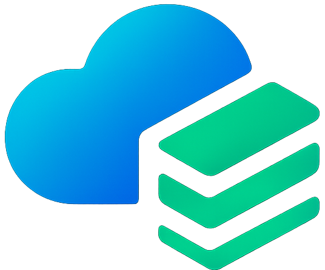
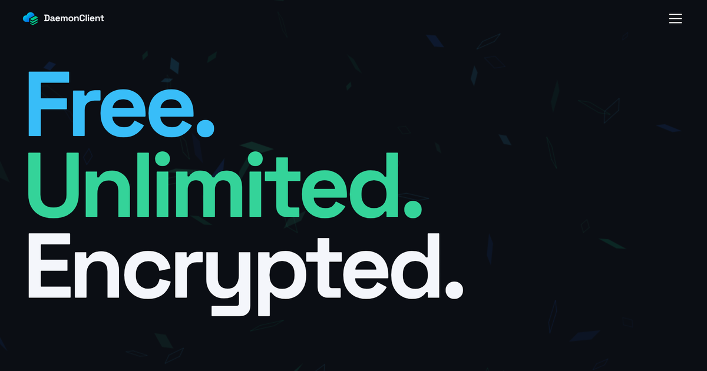
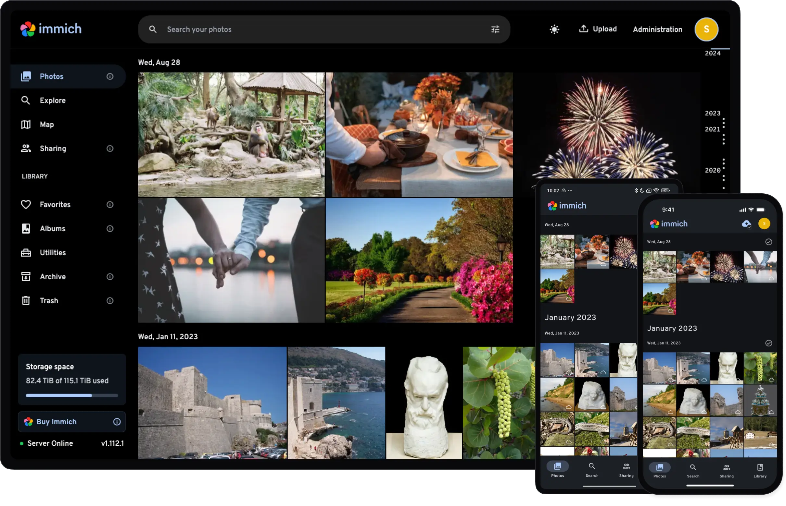
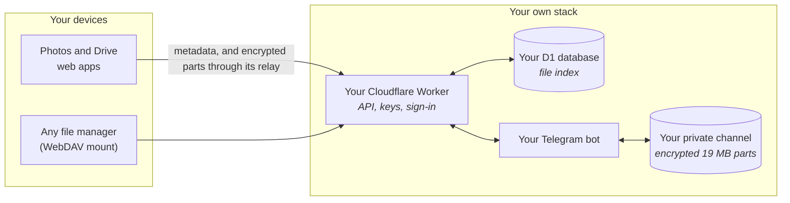

<p align="center">
  
</p>

<h1 align="center">DaemonClient</h1>

<p align="center">
  <strong>A private photo and file cloud that runs on free plans you control.</strong><br>
  <em>Photos and Drive, with your files in your own Telegram channel.</em>
</p>

<p align="center">
  <a href="https://daemonclient.uz"></a>
  <a href="https://photos.daemonclient.uz"></a>
  <a href="https://drive.daemonclient.uz"></a>
</p>

<p align="center">
  
  
  
  
  
  
</p>

<p align="center">
  
</p>

---

## What this is

Cloud storage costs money every month, and the files sit on someone else's
servers. DaemonClient builds a personal cloud out of two services with
generous free plans: Telegram, which stores files without a size cap through
bots and channels, and Cloudflare Workers, which runs code and a small D1
database. Every user gets their own copy of the whole setup:

- their own Telegram bot and private channel, owned by them;
- their own Cloudflare worker and D1 database, which serve their API and keep
  their file index;
- their own encryption keys, so files are stored encrypted in their channel.

There's no shared file server and no database of ours holding everyone's
photos. A photo you upload is stored in your Telegram channel as encrypted
parts, and your worker keeps the index that lets your stack read it back.

You can also run all of it yourself. One command sets up a complete install on
your own Telegram, Cloudflare and Firebase accounts, and nothing in it points
back at us. See [Self-hosting](#self-hosting).

---

## Try it

| App | Address | What's there |
|---|---|---|
| Photos | [photos.daemonclient.uz](https://photos.daemonclient.uz) | Timeline, albums, favourites, photo details, live photos, video, trash and zip downloads |
| Drive | [drive.daemonclient.uz](https://drive.daemonclient.uz) | Folders, previews, encryption in your browser, and a WebDAV mount |
| Accounts | [accounts.daemonclient.uz](https://accounts.daemonclient.uz) | One account for both apps, the guided setup and your dashboard |
| Docs | [docs.daemonclient.uz](https://docs.daemonclient.uz) | How it works, encryption, the API reference and self-hosting |

<p align="center">
  
</p>

---

## How it works



On the web, your browser does the heavy work: it splits and encrypts a file
itself and sends the parts to Telegram through your worker's relay, which
streams them along without storing or decrypting them. A service worker reads
files back the same way. The worker never assembles a whole file, which keeps
it inside the free plan's CPU and memory limits.

The parts we run are the control plane: the accounts portal, the sign-in
service and the service that sets up and updates each user's worker. None of
them is in the path of your files.

Three numbers explain most of the design:

| Number | Why it matters |
|---|---|
| 19 MB | Telegram won't let a bot download a file bigger than 20 MB, even though it accepts bigger uploads. Files are split below that limit and never merged. |
| 10 ms | The CPU time a free Cloudflare Worker gets per request: not enough to decode images, convert video or hold big buffers. |
| 50 | Outside requests per worker invocation. A 50-part file already reaches it, so background jobs run one at a time. |

The full explanation is in [docs/ARCHITECTURE.md](docs/ARCHITECTURE.md).

---

## Self-hosting

```bash
git clone https://github.com/myrosama/DaemonClient.git
cd DaemonClient
(cd workers/user-worker && npm install) && (cd selfhost && npm ci)
node selfhost/bin/daemonclient.mjs setup
```

Setup takes about ten minutes, most of it spent in Telegram and Cloudflare.
After that, `daemonclient web` builds the three web apps and deploys them to
your own Firebase Hosting. You need Node.js 22.13 or newer.

A self-hosted install doesn't use anything we run. Your files and credentials
stay on your own accounts, and nothing reports back to us. Apart from Telegram
and your own Firebase project, it contacts only GitHub's public releases list,
to check for updates; that request is anonymous, and there's no switch to turn
it off yet.
If this project disappeared, your install would keep working: the files are in
your Telegram channel, the index is in your D1 database, and the code is in
your clone under AGPL-3.0.

The full guide is [docs/SELF_HOSTING.md](docs/SELF_HOSTING.md).

---

## What works and what doesn't

### Working

Photos has a timeline grouped by month, with blurred placeholders while
thumbnails load, albums, favourites, archive, trash, photo details (camera,
lens, exposure), live photos, video that streams across parts, checksums so a
reinstall finds your existing photos instead of uploading them again, and zip
downloads. A background job fills in missing checksums while you browse.

Drive has folders, uploads of any size, previews, search, encryption in your
browser, and a WebDAV mount, so your cloud shows up as a normal drive in
Windows Explorer, macOS Finder or any other file manager. By default Drive's
key is kept in your own D1 database so your devices and the mount can use it.
If you set a custom password instead, it never leaves your browser.

Across all three apps you get long sessions and one sign-in, and on the
hosted service we update each user's worker on a schedule.

### Not working yet

| Feature | Status |
|---|---|
| Phone apps | Native iPhone and Android apps on the Rust core ([`core/`](core)) are being built in [`apps/ios/`](apps/ios) and [`apps/android/`](apps/android). Not released yet. See the [roadmap](docs/ROADMAP.md). |
| HEIC and some video thumbnails | Workers can't decode HEIC, and Telegram doesn't make thumbnails for it. In Photos, *Utilities > Fix HEIC & missing thumbnails* makes them in your browser, and *Fix video thumbnails* does the same for videos. |
| Face recognition, smart search, places | Not built. They need machine learning, and this design has nowhere to run it. Those routes return empty results of the right shape instead of errors. |
| Sharing between users | Not available. An install has one owner. |

[Known sharp edges](docs/ARCHITECTURE.md#known-sharp-edges) has more detail.

---

## Security

- Drive encrypts files in your browser before upload. By default the key is in
  your own D1 database, so your devices and the WebDAV mount can use it; with a
  custom password, only your browser can decrypt.
- Photos keeps its key in your own D1 database and stores your photos
  encrypted in your channel. Your worker holds that key so it can work out
  checksums and read photo details, and that worker serves only you.
- Your files never pass through a server we share between users. Work that
  needs real CPU, such as decoding HEIC photos, runs in your browser.
- An install has one owner. The check sits in the one place every request is
  authenticated, so new routes are covered too.

If you find a security problem, please report it privately: see
[SECURITY.md](SECURITY.md). Past issues are listed there too, because they show
the kind of thing worth looking for.

---

## Repository map

| Folder | What's there |
|---|---|
| [`workers/user-worker/`](workers/user-worker) | Each user's own worker: the whole Photos and Drive API, with encryption, Telegram I/O, D1 and background repair |
| [`workers/deployment/`](workers/deployment) | Sets up each user's worker for the hosted service and keeps it updated |
| [`workers/auth/`](workers/auth) | The sign-in service the websites share (hosted service only) |
| [`workers/telegram-proxy/`](workers/telegram-proxy) | A CORS relay for the Telegram Bot API |
| [`apps/photos-web/`](apps/photos-web) | The Photos website, a fork of Immich's web app ([FORK.md](apps/photos-web/FORK.md)) |
| [`apps/drive-web/`](apps/drive-web) | The Drive website |
| [`apps/accounts-web/`](apps/accounts-web) | Sign-up, the guided setup and the dashboard |
| [`apps/site/`](apps/site), [`apps/docs-web/`](apps/docs-web) | The landing page and the docs site |
| [`apps/ios/`](apps/ios), [`apps/android/`](apps/android) | The native phone apps, being built |
| [`core/`](core) | The Rust core under the phone apps: storage format, Telegram, sync and uploads |
| [`packages/schema/`](packages/schema) | The D1 database schema, defined once |
| [`selfhost/`](selfhost) | The self-hosting command-line tool |
| [`docs/`](docs) | Architecture, the API reference and the self-hosting guide |

Most folders have a README that explains what's in them and how to run it.

---

## Contributing

Start with [CONTRIBUTING.md](CONTRIBUTING.md). It explains where things live,
the four hard limits behind most of the odd-looking code, and the mistakes
already made so you don't have to repeat them.

```bash
cd workers/user-worker
npm install
npm test
npx tsc --noEmit
```

Please don't test against anyone else's deployment, ours included.
Self-hosting gives you a full setup on free plans in about ten minutes; test
there.

---

## Built on

- [Immich](https://github.com/immich-app/immich), the self-hosted photo platform
  the Photos website is forked from. If you want a conventional gallery on your
  own hardware, use it and give it a star.
  [apps/photos-web/FORK.md](apps/photos-web/FORK.md) lists what we changed.
- The Telegram Bot API, for storage.
- Cloudflare Workers and D1, which make a separate stack per user free.

## Before you rely on it

- DaemonClient is in beta. It's used every day and handled with production
  care, but expect rough edges.
- Your files live in your Telegram channel under Telegram's Terms of Service.
  Keep the bot in the channel and don't delete the channel's messages, because
  those messages are your files.
- If you lose your encryption key, the files already stored can't be
  recovered. There's no backdoor.

## Licence

[AGPL-3.0-or-later](LICENSE). See [NOTICE](NOTICE) for attribution and
trademarks. DaemonClient is not affiliated with or endorsed by Telegram,
Cloudflare, Google or the Immich project.
